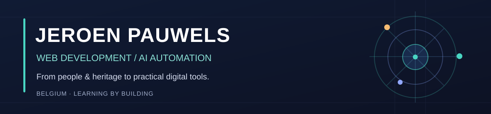

### Hi, I'm Jeroen 👋

**Web Development Student · AI Automation Explorer · Building Useful Tools**

*Human perspective. Developer mindset. Learning by building.*

## 👋 A little about me

I'm making a **career switch into web development and AI automation** after working in **cultural heritage, technical operations and customer support**.

Those experiences taught me to listen, solve practical problems, work with different people and explain complex things clearly. Now I'm bringing that perspective into technology.

I'm studying **Web Fundamentals & AI Assistance at SyntraPXL**, as part of my full-stack development and AI automation learning path.

I enjoy turning ideas into small, useful tools. I use AI to assist my development work, but I also want to **read, understand, test and explain the code**.

> **My unique angle:** combining a people-first background with curiosity about technology — building tools that are useful, accessible and easy to understand.

## 🛠️ What I'm learning and using

  

**Web:** HTML · CSS · Responsive Design · Bootstrap · JavaScript  
**Data & APIs:** SQL / MySQL · REST APIs · JSON · Fetch  
**Workflow:** Git · GitHub · VS Code · Linux · Debugging

**Exploring through projects:** React · TypeScript · Python · AI-assisted automation

*I'm a student, not an expert in everything listed here. This profile is a record of what I'm learning and building.*

## 🚀 Selected projects

| Project | What it does | Links |
| --- | --- | --- |
| 🌍 **World Time** | An interactive world clock with city search and time zones. | [Try it](https://worldtime.othrys.be/) |
| ⏱️ **Unix Time** | A practical Unix timestamp and date converter. | [Try it](https://unixtime.othrys.be/) |
| 📄 **FillThisPDF** | A free browser-based PDF form filler, no account required. | [Try it](https://vtcbelgium.github.io/fillthispdf-web/) · [Source](https://github.com/vtcbelgium/fillthispdf-web) |

**More small experiments:** [Free QR](https://vtcbelgium.github.io/freeqr-pages/) · [Shrink My Photo](https://vtcbelgium.github.io/shrinkmyphoto-pages/) · [QuickPercent](https://vtcbelgium.github.io/quickpercent-pages/)

The projects are works in progress and are often built with AI assistance. I use them to practice developing, testing, improving and maintaining real applications.

## 🏛️ OTHRYS

[**OTHRYS**](https://othrys.be/) is my personal project space for simple web utilities and experiments with development automation. The tools above are independent projects. Some repositories are private, and the larger automation ideas are still in development.

## 📚 Currently focused on

- Learning to build responsive websites and understand **JavaScript**
- Working with **REST APIs, JSON and MySQL**
- Getting better at **Git, pull requests, testing and debugging**
- Exploring **responsible AI-assisted development**

Beyond technology, I enjoy history, archaeology, cultural heritage and travel. I'm interested in internship opportunities where I can contribute, keep learning and work with an experienced team.

---

**Curiosity brought me here. Building things keeps me learning.**

Made with Markdown, a little HTML, and a lot of curiosity.

